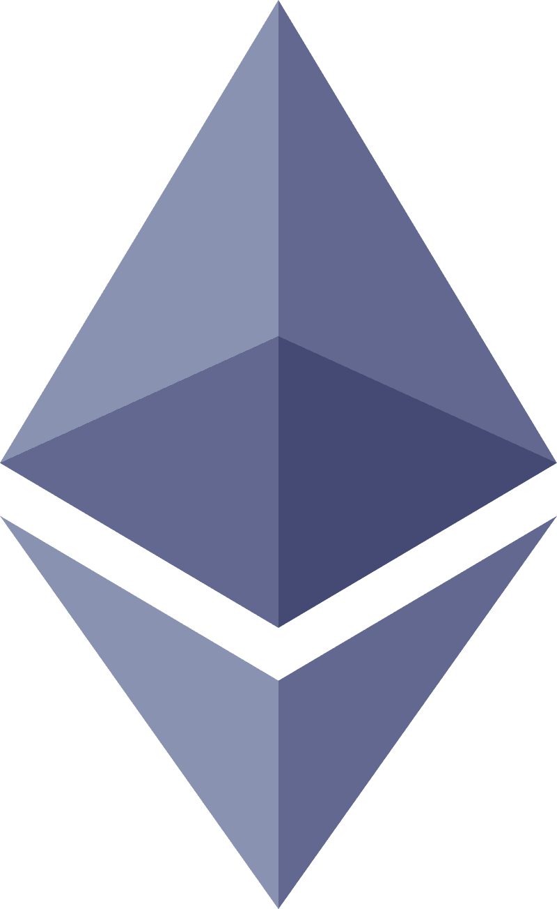
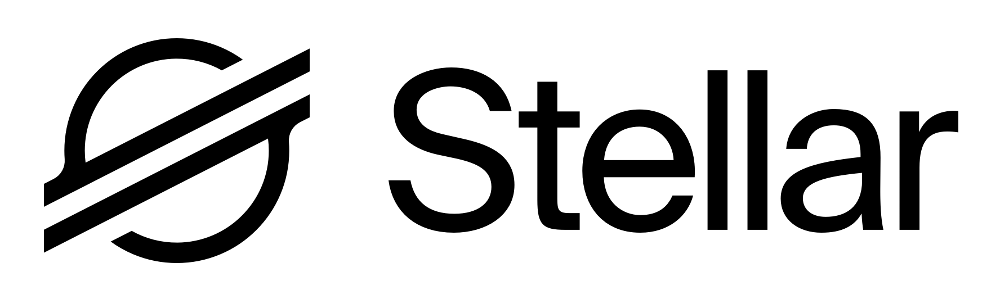

# Certora Formal Verification Resources

A curated list of resources for Formal Verification with Certora Prover. Please create a PR if you'd like to update it.

[General ↓](#general) · [EVM ↓](#evm) · [Stellar ↓](#stellar) · [Solana ↓](#solana) · [Sui ↓](#sui) · [NEAR ↓](#near)

### General
`updated: October 2026`

### Docs

-  [LLMs as Verification Oracles for Solidity](https://arxiv.org/abs/2509.19153)
  GPT-5 judging property validity, benchmarked against the Certora Prover and SolCMC
  Massimo Bartoletti, Enrico Lipparini & Livio Pompianu, Sep 2025

-  [A Guide to Formal Verification](https://www.certora.com/blog/formal-verification)
  Introduction to FV concepts and Certora approach
  Chandrakana Nandi & Mooly Sagiv, Apr 2025

-  [The Three Prompts of Spec Thinking: Yet Another Lens for Smart Contract Auditing](https://justdravee.github.io/posts/the-3-prompts-of-spec-thinking/)
  Framework for writing properties and invariants through three guiding questions
  Dravee, Apr 2025

-  [Certora Technology White Paper](https://www.certora.com/blog/white-paper)
  How the Prover works, its capabilities and limitations
  Chandrakana Nandi, Mooly Sagiv & Daniel Jackson, Feb 2025

-  [Practical Verification of Smart Contracts using Memory Splitting](https://dl.acm.org/doi/10.1145/3689796) ([Video](https://www.youtube.com/watch?v=NAyCz6NaMqU))
  Prover memory analysis and splitting for scalable EVM bytecode verification (OOPSLA 2024)
  Shelly Grossman, John Toman et al., Oct 2024

-  [PropertyGPT: LLM-driven Formal Verification of Smart Contracts](https://arxiv.org/abs/2405.02580)
  Uses 61 Certora audit reports as knowledge base for property generation (NDSS 2025)
  Ye Liu, Yue Xue, Daoyuan Wu et al., May 2024

-  [Catch Tricky Bugs in Less Time Using Formal Verification](https://www.certora.com/blog/catch-tricky-bugs-in-less-time-using-formal-verification)
  Why FV catches bugs that testing and audits miss
  Armen Ter-Avetisyan, Apr 2024

-  [Towards Benchmarking of Solidity Verification Tools](https://arxiv.org/abs/2402.10750)
  Open benchmark comparing the Certora Prover and SolCMC on soundness and expressiveness
  Massimo Bartoletti, Fabio Fioravanti, Giulia Matricardi et al., Feb 2024

-  [Trust but Verify: Scaling Deductive Verification with Abstract Interpretation](https://popl24.sigplan.org/details/N40AI-2024-papers/8/Trust-but-Verify-Scaling-Deductive-Verification-with-Abstract-Interpretation)
  Certora's pointer analysis for EVM bytecode (POPL 2024)
  Mooly Sagiv, Jan 2024

-  [Overapproximation of Non-Linear Integer Arithmetic for Smart Contract Verification](https://arxiv.org/abs/2402.10174) ([EasyChair](https://easychair.org/publications/paper/BlrQ))
  Prover's LIA and NRA overapproximations of non-linear arithmetic, benchmarked (LPAR 2023)
  Petra Hozzová, Jaroslav Bendík, Alexander Nutz & Yoav Rodeh, Jun 2023

-  [5 Myths About Formal Verification](https://www.certora.com/blog/5myths)
  Common misconceptions about FV debunked
  Mooly Sagiv, Dec 2022

-  [Verification For Dummies: SMT and Induction](https://ocamlpro.github.io/verification_for_dummies/index.html)
  Fundamentals of SMT solvers, transition systems, BMC, induction and candidate strengthening
  OCamlPro: Adrien Champion

### Videos

- ![yt][yt] [Formal Verification in the AI Era](https://www.youtube.com/watch?v=k1KzpGfJPhk)
  What FV is and is not, why tests and audits fall short, and why AI makes FV essential
  Certora: Mooly Sagiv, Aug 2026

- ![yt][yt] [Why Formal Verification Matters: Fireside Chat with Certora CEO Mooly Sagiv](https://www.youtube.com/watch?v=2tARWL61wCo)
  FV role in smart contract security, Certora vision
  RareTalks, May 2025

- ![yt][yt] [Building a Mental Model of a Smart Contract](https://www.youtube.com/watch?v=dQLZCArP53I)
  Breaking a protocol down into its essential properties as the basis for audits and specs
  ETHDenver: Uri Kirstein, Feb 2024

- ![yt][yt] [Dravee: Mindsets of Auditing](https://www.youtube.com/watch?v=kORcOhftwVw)
  Auditing mindsets and approaches to smart contract security
  OpenSense, Jun 2023

- ![yt][yt] [What is Certora and Formal Verification — Simply Explained](https://www.youtube.com/watch?v=8ON0Vpo7zls)
  Beginner-friendly introduction to Certora and FV
  JohnnyTime, Aug 2023

- ![yt][yt] [Getting a Full-Time Web3 Security Researcher Job at Certora](https://www.youtube.com/watch?v=tjdE3vzp4BA)
  Career path into FV and smart contract security
  JohnnyTime, Jul 2023

- ![yt][yt] [Bad Proofs in Formal Verification](https://www.youtube.com/watch?v=U-4D7tWLNNo)
  How vacuous rules, wrong assumptions and over-approximation give proofs that prove nothing
  Devcon Bogotá: Uri Kirstein, Oct 2022

### Works

- ![gh][gh] [Certora Security Reports](https://github.com/Certora/SecurityReports)
  Collection of formal verification reports across all chains
  Certora, Aug 2026

### Libs & Tools

- ![gh][gh] [Certora Prover](https://github.com/Certora/CertoraProver)
  Automated formal verification of smart contracts for EVM, Solana, Stellar and Sui
  Certora, Sep 2026

- ![gh][gh] [CVLR — Rust verification primitives](https://github.com/Certora/cvlr)
  Rust libraries for writing formal specs of Solana and Soroban contracts
  Certora, Aug 2026

- ![gh][gh] [CVLR Collections](https://github.com/Certora/cvlr-collections)
  Vectors and other collections mocks, fakes, and summaries for CVLR
  Certora, Apr 2025

- ![gh][gh] [GitHub Action for running Certora Prover](https://github.com/Certora/certora-run-action)
  CI/CD integration for automated Prover runs
  Certora, Sep 2026

- ![gh][gh] [Timeouter](https://github.com/Certora/timeouter)
  Re-runs a timed-out Prover job with a portfolio of about 10 solver configurations
  Certora, Sep 2026

- ![gh][gh] [ProverCLI](https://github.com/Certora/ProverCLI) ([PyPI](https://pypi.org/project/certora-prover-cli/))
  Python API and CLI for fetching and parsing Prover results, call traces and statistics
  Certora, Oct 2026

---

### EVM
`updated: October 2026`

### Docs

-  [Official documentation for Certora Prover](https://docs.certora.com/en/latest/docs/user-guide/install.html) ([GitHub](https://github.com/Certora/Documentation))
  Setup, configuration, CVL language reference and examples

-  [CVL Language Reference](https://docs.certora.com/en/latest/docs/cvl/index.html)
  Complete CVL specification language reference

-  [Certora Prover Tutorials](https://docs.certora.com/projects/tutorials) ([GitHub](https://github.com/Certora/tutorials-code))
  Step-by-step tutorials for learning CVL and the Prover

-  [Foundry Integration](https://docs.certora.com/en/latest/docs/cvl/foundry-integration.html)
  Using Foundry tests as Certora Prover specifications

-  [Book of Formal Verification with Certora Prover](https://rareskills.io/certora-book)
  Comprehensive CVL guide from basics to advanced patterns
  RareSkills: Jeffrey Scholz

-  [Formal Verification & Assembly course](https://updraft.cyfrin.io/courses/formal-verification)
  Video course covering CVL, assembly and FV fundamentals
  Cyfrin Updraft: Patrick Collins

-  [The Tectonic Exploit: A $120.4M Collateral Inflation Attack](https://www.certora.com/blog/tectonic-exploit-120million-collateral-inflation-attack)
  Tectonic exploit post-mortem with public Prover runs on the deployed tTONIC contract
  Mooly Sagiv, Sep 2026

-  [We Spec'd the Aave v4 Hub by Hand. Then We Let AutoProver Try](https://www.certora.com/blog/autoprover-aave-v4-hub-formal-verification)
  Hand-written vs AutoProver-generated CVL for the Aave v4 Hub: what each proved and missed
  Pamina Georgiou, Aug 2026

-  [Designing Solidity Contracts That Don't Fight Formal Verification](https://www.certora.com/blog/designing-solidity-contracts-for-easier-formal-verification) ([EthCC talk](https://www.youtube.com/watch?v=B31qKxKvaEg))
  Solidity patterns that hinder the Prover, and verification-friendly rewrites
  Pamina Georgiou, Apr 2026

-  [Breaking Down the Balancer Hack](https://www.certora.com/blog/breaking-down-the-balancer-hack)
  Rounding root cause of the Nov 2025 Balancer exploit and a Prover property for the bug
  Tomer Ganor, Lior Oppenheim, Gad Elbaz, Pamina Georgiou & Alex Van Der Lelie, Nov 2025

-  [Finding Compiler Bugs with Formal Verification](https://www.certora.com/blog/finding-compiler-bugs-with-formal-verification)
  Using Certora Prover to find Solidity compiler bugs
  John Toman, Jun 2025

-  [Ensuring Fair Redemptions in InfiniFi with Formal Verification](https://www.certora.com/blog/ensuring-fair-redemptions-in-infinifi-with-formal-verification)
  FV case study on redemption fairness in InfiniFi protocol
  Pamina Georgiou & Andrew Ferraiuolo, Jun 2025

-  [Securing Uniswap v4](https://www.certora.com/blog/securing-uniswap-v4-part-5)
  FV findings and methodology for Uniswap v4 Core
  Roy Perry, May 2025

-  [When One Wei Costs Millions](https://www.certora.com/blog/when-one-wei-costs-millions)
  Rounding bugs in lending and the generic 'golden rules' that caught two in a live protocol
  Lior Oppenheim, Apr 2025

-  [Learning CVL Language](https://rasengansec.hashnode.dev/learning-certora-prover-part-1) ([Part 2](https://rasengansec.hashnode.dev/learning-certora-prover-part-2), [Part 3](https://rasengansec.hashnode.dev/learning-cvl-language-part-3), [Part 4](https://rasengansec.hashnode.dev/learning-cvl-language-part-4))
  Hands-on walkthrough: CVL syntax, rules, invariants, hooks
  Certora: Lilian Cariou, Mar-Apr 2025

-  [Proving Solvency in Uniswap's AMM](https://www.certora.com/blog/proving-solvency-in-uniswaps-amm) ([Devcon talk](https://www.youtube.com/watch?v=CnrZyDeGwKI))
  Invariant-based solvency proof for the Uniswap v4 AMM using ghosts, hooks and SMT
  Jochen Hoenicke, Mar 2025

-  [Certora FV Practical Guide: Insights from the Badger eBTC Competition](https://alexzoid.com/certora-formal-verification-practical-guide)
  Practical workflow and methodology from Badger eBTC FV competition
  alexzoid, Mar 2025

-  [Find Highs Before External Auditors Using Certora Formal Verification](https://dacian.me/find-highs-before-external-auditors-using-certora-formal-verification) ([GitHub](https://github.com/devdacian/solidity-fuzzing-comparison))
  Practical guide to finding critical bugs with CVL, fuzzing tools comparison
  Dacian, Feb 2025

-  [Inside Certora FV Contests: A Step-by-Step Guide Based on the Uniswap v4 Contest](https://alexzoid.com/practical-guide-to-certora-formal-verification-contests)
  Contest structure, best practices and mutation bug walkthrough
  alexzoid, Feb 2025

-  [First Steps with Certora FV: Catching a Real Bug with a Universal 5-Line Rule](https://alexzoid.com/first-steps-with-certora-fv-catching-a-real-bug)
  Beginner-friendly setup and a universal CVL rule for storage bugs
  alexzoid, Feb 2025

-  [Formal Verification: Securing ERC-4626 Vaults with Certora Prover](https://zokyo.io/blog/formal-verification-certora/)
  ERC-4626 vault spec: ghosts, hooks, sum-of-balances invariants and havocing pitfalls
  Zokyo, Feb 2025

-  [Certora Tutorial Lecture Notes](https://certora-presentations.readthedocs-hosted.com/en/latest/) ([GitHub](https://github.com/Certora/basic-presentation))
  Notes and exercises for a 90-minute Prover intro, from voting rules to a flashloan exploit
  Certora, Nov 2024

-  [The Holy Grail - Proving Against the Unknown for DeFi Protocols](https://www.certora.com/blog/the-holy-grail) ([Specs](https://github.com/euler-xyz/euler-vault-kit/tree/master/certora))
  Proving that Euler V2 accounts stay healthy while prices do not move, with full CVL specs
  Andrew Ferraiuolo, Aug 2024

-  [Certora vs Echidna: a case study on invariant testing in eBTC](https://allthingsfuzzy.substack.com/p/certora-vs-echidna-a-case-study-on) ([GitHub](https://github.com/nican0r/eBTC-certora-vs-echidna))
  Three eBTC properties in Echidna and CVL compared by code size, runtime and summaries
  nican0r, Jan 2024

-  [Formally Verifying Morpho Blue with Certora](https://paragraph.com/@morpho/formally-verifying-morpho-blue-with-certora) ([GitHub](https://github.com/morpho-org/morpho-blue))
  FV methodology and findings for Morpho Blue
  Morpho, Dec 2023

-  [How to Optimize Your Gas Consumption Without Getting REKT](https://www.certora.com/blog/optimize-gas-without-getting-rekt-part-1) ([Part 2](https://www.certora.com/blog/rekt-part-2), [DSS 2023 talk](https://www.youtube.com/watch?v=bvvmA6mhaZg))
  Hand-written CVL equivalence checks for gas-optimized code; Part 2 applies them to PRBMath
  Netanel Rubin-Blaier, Apr-Sep 2023

-  [Decompiling Vyper Programs for Formal Verification](https://www.certora.com/blog/vyper-announcement)
  How the Prover recovers memory structure from Vyper bytecode to verify Vyper contracts
  John Toman & Jochen Hoenicke, Aug 2023

-  [Silo Finance - Post Mortem](https://www.certora.com/blog/silo-finance-post-mortem)
  Why Silo's 200 verified rules missed a utilization bug, and the rules added after it
  Uri Kirstein, Jun 2023

-  [When Invariants Aren't: DAI's Certora Surprise](https://hackmd.io/@SaferMaker/DAICertoraSurprise) ([Spec](https://github.com/kmbarry1/fund-eq-of-dai-certora))
  Prover counterexample to the Fundamental Equation of DAI, long assumed to hold in Maker
  Kurt Barry & Uri Kirstein, Jun 2022

-  [Post-Mortem Analysis of the Notional Finance Vulnerability](https://www.certora.com/blog/post-mortem-analysis-of-the-notional-finance-vulnerability) ([Spec](https://github.com/notional-finance/contracts-v2/blob/certora-hf/certora/accountContext/ActiveCurrencies.spec))
  A tautological invariant that hid a critical bug, and why vacuity checks matter
  Uri Kirstein, Jan 2022

### Videos

- ![yt][yt] [Certora AutoProver Demo: How AutoProver Automates Formal Verification](https://www.youtube.com/watch?v=ZJ0KMwR_NvU)
  AutoProver turns code, design docs and threat models into CVL rules checked by the Prover
  Certora, Aug 2026

- ![yt][yt] [Using LLM Generated Formal Specs to Prevent the Next DeFi Hack](https://www.youtube.com/watch?v=lpx5ulFyCL8)
  Why code from coding agents needs LLM-generated formal specs checked by the Prover
  ETHConf: Mooly Sagiv, Jul 2026

- ![yt][yt] [Designing DeFi Resilience: Inside Aave V4 Security Blueprint](https://www.youtube.com/watch?v=0k88M8l-l68) ([DSS 2025 version](https://www.youtube.com/watch?v=4edq_EiDZ84))
  Aave V4 architecture, threat models and the role of Certora Prover verification
  EthCC: Tomer Ganor, Apr 2026

- ![yt][yt] [AI Composer: Safe Vibe Coding](https://www.youtube.com/watch?v=1KR0GnxhNz4) ([ETHDenver version](https://www.youtube.com/watch?v=GgXLO585baU))
  Why LLM-written DeFi code misses security logic and how AI Composer constrains it
  EthCC: Mooly Sagiv, Apr 2026

- ![yt][yt] [Formal Verification for Ethereum's Next Scalability Era / FV and LLMs Together](https://www.youtube.com/watch?v=gwT-EKXd2JI)
  How the Certora Prover works, its role in Ethereum scaling, and LLM-assisted verification
  Ethereum & AI Engineering Group: Mooly Sagiv, Mar 2026

- ![yt][yt] [Proving Correctness of LLM-Generated Smart Contracts](https://www.youtube.com/watch?v=6VfRtVTj__U)
  Verifying AI-generated smart contracts with Certora
  ETHDenver: John Toman, Feb 2026

- ![yt][yt] [AI Meets Verification: Introducing Certora AI Composer](https://www.youtube.com/watch?v=6jtgbK43QOE)
  AI-powered generation of verified implementations
  Certora, Dec 2025

- ![yt][yt] [Verifying LLM Powered Code Transformations with Equivalence Checking](https://www.youtube.com/watch?v=41rc9u98Asw)
  Equivalence checking proves LLM rewrites of optimized code into readable Solidity
  Solidity Summit: John Toman, Dec 2025

- ![yt][yt] [Concord: Automatically Checking EVM Bytecode Equivalence](https://www.youtube.com/watch?v=tgoCIkG5zZw)
  Workshop on Concord, Certora's bytecode equivalence checker for compiler and LLM output
  DeFi Security Summit: John Toman, Nov 2025

- ![yt][yt] [DeFi Security 101: From Fuzzing to Formal Verification](https://www.youtube.com/watch?v=CIt4kphfuyI)
  Overview of DeFi security tools from fuzzing to FV
  DeFi Security Summit: Kevin Lotz, Nov 2025

- ![yt][yt] [Formal Verification of Uniswap v4 Hooks](https://www.youtube.com/watch?v=6TqMiOdHKhA)
  FV approach to Uniswap v4 hook verification
  DeFi Security Summit: Jochen Hoenicke, Nov 2025

- ![yt][yt] [Secure By Design: Intro to FV for Uniswap v4 Hooks with Certora](https://www.youtube.com/watch?v=9tV11RtZ0Pw)
  Hands-on introduction to verifying Uniswap v4 hooks
  Atrium Academy, Aug 2025

- ![yt][yt] [Securing AI-Assisted DeFi Development with Formal Verification](https://www.youtube.com/watch?v=lCY0--mo_s0)
  FV role in AI-assisted DeFi development
  EthCC: Mooly Sagiv, Jul 2025

- ![yt][yt] [Best of Both Fuzzing and Formal Verification](https://www.youtube.com/watch?v=16bI2bzVkPE)
  Combining fuzzing and FV approaches
  EthCC: Uri Kirstein, Jul 2025

- ![yt][yt] [Securing Your Protocol with the Certora Prover](https://www.youtube.com/watch?v=uDUS0XSrhPU)
  Practical guide to protocol verification
  EthCC: Pamina Georgiou, Jul 2025

- ![yt][yt] [Satisfiability Modulo Finite Fields // The Certora Prover](https://www.youtube.com/watch?v=onB0nzyRN2k)
  SMT solving techniques behind the Certora Prover
  TUM Blockchain Club: Gereon Kremer, Oct 2024

- ![yt][yt] [Dive into Formal Verification - Prepare for Uniswap V4's $100K Competition!](https://www.youtube.com/watch?v=bbjnVoVN9hc)
  90-minute Certora Prover webinar ahead of the Uniswap v4 FV contest
  Certora, Sep 2024

- ![yt][yt] [Certora Formal Verification Workshop - HackerHaus Berlin 2024](https://www.youtube.com/watch?v=H-ENWOuc4QY)
  Hands-on CVL workshop on Euler v2 for the Cantina code competition
  Euler Labs: Andrew Ferraiuolo, May 2024

- ![yt][yt] [HackerHaus Livestream — Euler Labs x Spearbit x Certora](https://www.youtube.com/watch?v=fGb7W1LAt98)
  Joint session on smart contract security and FV
  Euler Labs, May 2024

- ![yt][yt] [How Good Is Your Formal Specification? Mutation Testing To The Rescue!](https://www.youtube.com/watch?v=g3dxF7XfBWk)
  Measuring and improving formal spec quality with mutation testing (Gambit)
  Solidity Summit: Chandrakana Nandi, Nov 2023

- ![yt][yt] [Checking Specifications - What's the Quality of My Rules?](https://www.youtube.com/watch?v=PjUua2Hi1GA)
  Webinar on assessing the quality and coverage of CVL specifications
  Certora, Nov 2023

- ![yt][yt] [Getting started with Certora Prover - a Practical Introduction](https://www.youtube.com/watch?v=DtVj788m3Qo)
  Practical introduction to the Prover: key setup, installation and first runs
  Certora, Nov 2023

- ![yt][yt] [How to Prevent Prover Timeouts](https://www.youtube.com/watch?v=mntP0_EN-ZQ)
  Webinar on debugging and preventing Prover timeouts
  Certora, Sep 2023

- ![yt][yt] [What's New in CVL2](https://www.youtube.com/watch?v=Gle2-dB2m94)
  Methods block, summaries, calledContract, nativeBalances, storage comparison, satisfy
  Certora, Aug 2023

- ![yt][yt] [Formally Verifying Morpho](https://www.youtube.com/watch?v=tOnqf7_rATE)
  How Morpho uses Certora, Halmos and Why3, and which tool fits which verification task
  DeFi Security Summit: Quentin Garchery, Jul 2023

- ![yt][yt] [Practical Formal Verification of EVM Bytecode](https://www.youtube.com/watch?v=xpbiohmmF9A)
  Research talk on checking specs against compiled bytecode rather than Solidity source
  CMU Secure Blockchain Summit: Chandrakana Nandi, May 2023

- ![yt][yt] [Scaling Formal Verification to Realistic Code with Applications to DeFi Verification](https://www.youtube.com/watch?v=P7ZlnTIJtSk)
  ESOP invited keynote on scaling the Certora Prover to real DeFi code
  ETAPS 2023: Mooly Sagiv, Apr 2023

- ![yt][yt] [Getting Started with Certora Prover](https://www.youtube.com/watch?v=jv_1hEeG-lk)
  Official getting started tutorial
  Certora, Apr 2023

- ![yt][yt] [Scaling Formal Verification to Find Bugs in Complex Smart Contract Systems](https://www.youtube.com/watch?v=kKVL3Fn6ZTk)
  FV scalability for complex smart contracts
  ETHGathering, Feb 2023

- ![yt][yt] [Fuzzing Tools Series: Certora Prover](https://www.youtube.com/watch?v=9Gal-on-06E)
  Certora Prover overview and demo
  Spearbit, Jul 2022

### Works

- ![gh][gh] [MetaMorpho](https://github.com/morpho-org/metamorpho)
  Vault protocol with CVL specs
  Morpho, Aug 2026
- ![gh][gh] [MetaMorpho V1.1](https://github.com/morpho-org/metamorpho-v1.1/tree/main/certora)
  Vault protocol v1.1 with CVL specs, including lost-assets rules
  Morpho, Jun 2026
- ![gh][gh] [Morpho Blue](https://github.com/morpho-org/morpho-blue/tree/main/certora)
  Lending protocol with CVL specs
  Morpho, Sep 2026
- ![gh][gh] [Morpho Pre Liquidation](https://github.com/morpho-org/pre-liquidation)
  Pre-liquidation module with CVL specs
  Morpho, Apr 2026
- ![gh][gh] [Morpho Vault V2](https://github.com/morpho-org/vault-v2)
  Vault module with CVL specs
  Morpho, Sep 2026
- ![gh][gh] [Morpho Midnight](https://github.com/morpho-org/midnight/tree/main/certora)
  Fixed-rate lending protocol with CVL specs
  Morpho, Oct 2026
- ![gh][gh] [Morpho Bundler3](https://github.com/morpho-org/bundler3/tree/main/certora)
  Call bundler with CVL specs for reentrancy, auth and reverts
  Morpho, Oct 2025
- ![gh][gh] [Morpho Token](https://github.com/morpho-org/morpho-token/tree/main/certora)
  MORPHO token with bridging, CVL specs for ERC20, delegation and reverts
  Morpho, Aug 2026
- ![gh][gh] [Morpho Midnight](https://github.com/alexzoid-eth/morpho-midnight-fv/tree/main/certora)
  Independent fixed-rate lending protocol FV specs
  Tenor/alexzoid, Jul 2026
- ![pdf][pdf] [Morpho Midnight](https://github.com/alexzoid-eth/fv-track-record/blob/main/pdf/2026_05_morpho_midnight_fv_report_alexzoid.pdf)
  Fixed-rate lending protocol FV report
  Tenor/alexzoid, Jun 2026
- ![gh][gh] [Morpho Blue](https://github.com/alexzoid-eth/morpho-blue-fv/tree/main/certora)
  Independent lending protocol FV specs with mutation confs
  Tenor/alexzoid, May 2026
- ![pdf][pdf] [Morpho Blue](https://github.com/alexzoid-eth/fv-track-record/blob/main/pdf/2026_03_morpho_blue_fv_report_alexzoid.pdf)
  Lending protocol FV report
  Tenor/alexzoid, Mar 2026

- ![gh][gh] [Centrifuge](https://github.com/centrifuge/protocol-certora)
  RWA protocol core with CVL specs, 1589 properties and 1445 mutants
  Centrifuge/alexzoid, Oct 2026
- ![pdf][pdf] [Centrifuge Core](https://github.com/alexzoid-eth/fv-track-record/blob/main/pdf/2026_09_centrifuge_core_fv_report_alexzoid.pdf)
  RWA protocol core FV report (hub, spoke, messaging)
  Centrifuge/alexzoid, Sep 2026

- ![gh][gh] [EtherFi Cash](https://github.com/etherfi-protocol/cash-v3/tree/master/certora)
  Cash module, debt manager and safe with CVL specs maintained in CI
  EtherFi, Sep 2026

- ![gh][gh] [Candide Social Recovery Module](https://github.com/candidelabs/candide-contracts/tree/main/certora)
  Safe social recovery module with CVL specs and verification notes
  Candide, Sep 2026

- ![gh][gh] [Monad Spot CLOB](https://github.com/monad-developers/spot-clob/tree/main/certora)
  Onchain CLOB with CVL specs, tick price lemma and mutation testing CI
  Monad Developers, Sep 2026

- ![gh][gh] [Aave Governance V3](https://github.com/aave-dao/aave-governance-v3)
  Governance framework with CVL specs
  Aave, Jul 2026
- ![gh][gh] [Aave V3 Origin](https://github.com/aave-dao/aave-v3-origin)
  Lending protocol v3 with CVL specs
  Aave, Aug 2026
- ![gh][gh] [Aave V4](https://github.com/aave/aave-v4/tree/feat/certora-cvl-v0.5.11/certora)
  Lending protocol v4 with CVL specs
  Aave, Apr 2026
- ![gh][gh] [Aave V4 Risk Stewards](https://github.com/aave-dao/aave-v4-risk-stewards/tree/main/certora)
  Risk steward contracts for Aave v4 with CVL specs
  Aave, Sep 2026
- ![gh][gh] [GHO Core](https://github.com/aave/gho-core)
  GHO stablecoin with CVL specs
  Aave, Jan 2025
- ![gh][gh] [GHO Origin](https://github.com/aave-dao/gho-origin/tree/main/certora)
  GHO, GSM and stewards with CVL specs, successor of GHO Core
  Aave, Aug 2026
- ![gh][gh] [GHO FV Competition Report](https://github.com/Certora/gho-competition/blob/certora/competition/Report.md)
  Competition mutants and notable properties for GhoToken, GhoAToken and GhoFlashMinter
  Certora, Mar 2024
- ![gh][gh] [Aave Umbrella](https://github.com/aave-dao/aave-umbrella/tree/main/certora)
  Umbrella safety module, stake token and rewards with CVL specs and Certora reports
  Aave, Jun 2025
- ![gh][gh] [Aave Delivery Infrastructure](https://github.com/aave-dao/aave-delivery-infrastructure/tree/main/security/certora) ([Report](https://github.com/Certora/SecurityReports/blob/main/Reports/2023/07_15_2023_Aave_Delivery_Infrastructure-FV-MR.pdf))
  Cross-chain messaging layer (a.DI) with CVL specs for forwarding, retries and receiving
  Aave, Aug 2025
- ![gh][gh] [Aave Vault](https://github.com/aave/aave-vault/tree/main/certora) ([Report](https://github.com/Certora/SecurityReports/blob/main/Reports/2023/06_15_2023_Aave_Vault-FV-MR.pdf))
  ERC-4626 vault over aTokens, CVL specs for fees, yield accrual, previews and invariants
  Aave, Mar 2025
- ![pdf][pdf] [Aave StableVault](https://github.com/Certora/SecurityReports/blob/main/Reports/2026/Certora%20-%20Aave%20StableVault%20-%20FV.pdf)
  Stable vault, allocator and IOU token FV report
  Certora, Aug 2026
- ![pdf][pdf] [Aave V4 Hub](https://github.com/Certora/SecurityReports/blob/main/Reports/2026/07_08_2026_AaveV4-Hub_Formal_Verification.pdf)
  Lending protocol v4 Hub FV report
  Certora, Jul 2026
- ![pdf][pdf] [Aave V4 Spoke](https://github.com/Certora/SecurityReports/blob/main/Reports/2026/07_08_2026_AaveV4-Spoke_FV.pdf)
  Lending protocol v4 Spoke FV report
  Certora, Jul 2026
- ![pdf][pdf] [Aave V4 Libraries](https://github.com/Certora/SecurityReports/blob/main/Reports/2026/07_08_2026_AaveV4-Libraries_FV.pdf)
  Lending protocol v4 libraries FV report (LiquidationLogic, Premium, LibBit and others)
  Certora, Jul 2026
- ![pdf][pdf] [Aave V4 TokenizationSpoke](https://github.com/Certora/SecurityReports/blob/main/Reports/2026/07_08_2026_AaveV4-TokenizationSpoke_Formal_Verification.pdf)
  Lending protocol v4 ERC-4626 tokenization spoke FV report
  Certora, Jul 2026
- ![pdf][pdf] [Aave Risk Steward](https://github.com/Certora/SecurityReports/blob/main/Reports/2024/06_20_2024_Aave_Risk_Steward-FV-MR.pdf)
  Risk steward module FV report
  Certora, Jun 2024
- ![pdf][pdf] [Aave GhoStewardV2](https://github.com/Certora/SecurityReports/blob/main/Reports/2024/03_14_2024_Aave_GhoStewardV2-FV-MR.pdf)
  GHO steward module FV report
  Certora, Mar 2024

- ![gh][gh] [Sky DSS Flappers](https://github.com/sky-ecosystem/dss-flappers/tree/master/certora)
  Surplus flappers, kicker and splitter with CVL specs
  Sky, Sep 2026
- ![gh][gh] [Sky PAS](https://github.com/sky-ecosystem/pas/tree/master/certora)
  Timelocked, rate-limited allocation system with CVL specs
  Sky, Sep 2026
- ![gh][gh] [Sky stUSDS](https://github.com/sky-ecosystem/stusds/tree/master/certora)
  Staked USDS token, mom and rate setter with CVL specs
  Sky, Apr 2026
- ![gh][gh] [Sky Lockstake](https://github.com/sky-ecosystem/lockstake/tree/master/certora)
  SKY staking engine, urns and clipper with CVL specs
  Sky, Oct 2025
- ![gh][gh] [Sky Chief](https://github.com/sky-ecosystem/chief/tree/master/certora)
  Approval-voting governance with per-function CVL rules for effects and reverts, run in CI
  Sky, May 2025
- ![gh][gh] [Sky DSS Allocator](https://github.com/sky-ecosystem/dss-allocator/tree/dev/certora)
  Allocator vault, buffer, roles, registry, oracle and swap/deposit funnels with CVL specs
  Sky, Aug 2024

- ![gh][gh] [Safenet](https://github.com/safe-research/safenet/tree/main/certora)
  Transaction guard for Safe accounts and staking with CVL specs, 54 guard properties
  Safe Research, Sep 2026
- ![gh][gh] [Safe Locking](https://github.com/safe-fndn/safe-locking)
  Token locking module with CVL specs
  Safe, May 2024
- ![gh][gh] [Safe Smart Account](https://github.com/safe-fndn/safe-smart-account)
  Multisig wallet with CVL specs
  Safe, Feb 2026
- ![pdf][pdf] [Safe v1.5.0](https://github.com/Certora/SecurityReports/blob/main/Reports/2025/06_16_2025_Safe_v1.5.0-FV-MR.pdf)
  Multisig wallet v1.5.0 FV report
  Certora, Jun 2025

- ![pdf][pdf] [Polymarket V2](https://github.com/Polymarket/polymarket-v2-external/blob/main/audit/Formal%20Verification%20-%20Certora%20-%20August%202026.pdf) ([Specs](https://github.com/Polymarket/polymarket-v2-external/tree/main/certora))
  Prediction market exchange and module contracts FV report, with public Prover runs
  Certora, Aug 2026

- ![gh][gh] [Tenor](https://github.com/tenor-labs/tenor-contracts/tree/main/certora)
  Lending migration and renewal callbacks with CVL specs and mutation suites
  Tenor/alexzoid, Jul 2026
- ![pdf][pdf] [Tenor](https://github.com/alexzoid-eth/fv-track-record/blob/main/pdf/2026_06_tenor_fv_report_alexzoid.pdf)
  Lending migration and renewal callbacks FV report
  Tenor/alexzoid, Jul 2026

- ![pdf][pdf] [Royco](https://github.com/Certora/SecurityReports/blob/main/Reports/2026/07_08_2026_Royco_Formal_Verification.pdf) ([Specs](https://github.com/Certora/royco-dawn_fork/tree/certora/certora))
  Senior/junior tranche vault protocol FV report
  Certora, Jul 2026

- ![gh][gh] [Term Finance](https://github.com/term-finance/term-finance-contracts/tree/main/certora)
  Fixed-rate repo auctions, servicer, collateral manager and liquidations with CVL specs
  Term Finance, Jul 2026

- ![pdf][pdf] [Mezzanine](https://github.com/Certora/SecurityReports/blob/main/Reports/2026/06_29_2026_Mezzanine%20Protocol.pdf)
  Tranche yield protocol (MezzFi) FV report
  Certora, Jun 2026

- ![pdf][pdf] [Avant RequestManagerV2](https://github.com/Cyfrin/cyfrin-audit-reports/blob/main/reports/2026-06-25-cyfrin-avant-requestmanagerv2-FV-v2.0.pdf) ([Specs](https://github.com/Avant-Protocol/Avant-Contracts-Max/tree/master/certora))
  Mint and burn request manager FV report, one Low finding
  Cyfrin/Julius Raynaldi, Jun 2026

- ![gh][gh] [Reserve Index DTF](https://github.com/Certora/reserve-index-dtf/tree/certora/certora)
  Folio index DTF auctions with CVL specs for price monotonicity and bid splitting
  Certora, Jun 2026
- ![pdf][pdf] [Reserve Fixed Lib](https://github.com/Certora/SecurityReports/blob/main/Reports/2026/04_02_2026_Reserve_Fixed_lib-FV.pdf)
  Fixed-point math library FV report
  Certora, Apr 2026

- ![gh][gh] [Euler EVC](https://github.com/euler-xyz/ethereum-vault-connector/tree/master/certora)
  Ethereum Vault Connector with CVL specs organised by CER property
  Euler, May 2026
- ![gh][gh] [Euler Earn](https://github.com/euler-xyz/euler-earn/tree/master/certora) ([Report](https://github.com/euler-xyz/euler-earn/blob/master/audits/Certora_EulerEarn_report.pdf))
  Earn vault with CVL specs and Certora FV report
  Euler, Oct 2025
- ![pdf][pdf] [Euler EVK V3](https://github.com/Certora/SecurityReports/blob/main/Reports/2024/09_08_2024_Euler_EVK_V3-FV-MR.pdf)
  Euler Vault Kit v3 FV report
  Certora, Sep 2024
- ![gh][gh] [Euler Vault FV Competition Report](https://github.com/Certora/euler-vault-cantina-fv/blob/master/Report.md)
  Competition results, mutants and best rules with author attribution
  Cantina, Aug 2024
- ![pdf][pdf] [Euler Vault](https://github.com/alexzoid-eth/fv-track-record/blob/main/pdf/2024_06_euler_fv_report_cantina_alexzoid.pdf)
  Vault protocol FV report
  Cantina/alexzoid, Jun 2024

- ![pdf][pdf] [Armada Crowdfund & Governance](https://github.com/Cyfrin/cyfrin-audit-reports/blob/main/reports/2026-05-13-cyfrin-armada-crowdfund-governance-fv-v2.0.pdf)
  Crowdfund, governance, treasury and wind-down FV report, one Low and one Info finding
  Cyfrin/Arion, May 2026

- ![pdf][pdf] [Saturn Dollar M0 Extensions](https://github.com/Certora/SecurityReports/blob/main/Reports/2026/04_30_2026_Saturn_Dollar_M0_Extensions-FV-MR.pdf)
  M0-based USDat stablecoin and staking vault FV report
  Certora, Apr 2026

- ![gh][gh] [Lido Dual Governance](https://github.com/lidofinance/dual-governance)
  Dual governance mechanism with CVL specs
  Lido, Mar 2026
- ![gh][gh] [Lido V3 Core](https://github.com/lidofinance/core/tree/feat/certora-prover/certora)
  Lido V3 Accounting, VaultHub and stVaults CVL specs (feature branch)
  Lido/Certora, Mar 2026
- ![pdf][pdf] [Lido V3](https://github.com/Certora/SecurityReports/blob/main/Reports/2026/01_10_2026_Lido_V3_FV.pdf)
  Staking protocol v3 FV report
  Certora, Dec 2025
- ![pdf][pdf] [Lido DG ReAudit](https://github.com/Certora/SecurityReports/blob/main/Reports/2025/02_18_2025_Lido_DG_ReAudit-FV-MR.pdf)
  Dual governance re-audit FV report
  Certora, Feb 2025
- ![pdf][pdf] [Lido DG](https://github.com/Certora/SecurityReports/blob/main/Reports/2025/02_05_2025_Lido_DG-FV-MR.pdf)
  Dual governance FV report
  Certora, Feb 2025

- ![pdf][pdf] [Cozy Finance](https://github.com/Certora/SecurityReports/blob/main/Reports/2026/03_05_2026_Cozy_Finance_FV.pdf)
  DeFi safety protocol FV report
  Certora, Mar 2026

- ![gh][gh] [Liquid Collective](https://github.com/liquid-collective/liquid-collective-protocol/tree/main/certora) ([Report](https://github.com/Certora/SecurityReports/blob/main/Reports/2024/11_26_2024_Alluvial_LiquidCollective-FV-MR.pdf))
  Liquid staking protocol with CVL specs and CI
  Liquid Collective, Feb 2026

- ![pdf][pdf] [Parallel](https://github.com/alexzoid-eth/fv-track-record/blob/main/pdf/2026_02_parallel_fv_report_cyfrin_alexzoid.pdf)
  Stablecoin protocol FV report
  Cyfrin/alexzoid, Feb 2026

- ![gh][gh] [ABDK Math 64.64 Verification](https://github.com/gustavo-grieco/abdk-math-64.64-verification)
  crytic/properties invariants for ABDK 64.64 math checked with hevm and the Certora Prover
  Gustavo Grieco, Feb 2026

- ![pdf][pdf] [Predict](https://github.com/alexzoid-eth/fv-track-record/blob/main/pdf/2026_01_predict_dot_fun_fv_report_cyfrin_alexzoid.pdf)
  Prediction market FV report
  Cyfrin/alexzoid, Jan 2026

- ![pdf][pdf] [Accountable](https://github.com/alexzoid-eth/fv-track-record/blob/main/pdf/2025_10_accountable_fv_report_cyfrin_alexzoid.pdf)
  Credit vaults FV report
  Cyfrin/alexzoid, Oct 2025

- ![pdf][pdf] [L2 Angstrom](https://github.com/alexzoid-eth/fv-track-record/blob/main/pdf/2025_09_sorella_l2_angstrom_fv_report_cyfrin_alexzoid.pdf)
  L2 DEX protocol FV report
  Cyfrin/alexzoid, Sep 2025

- ![gh][gh] [Licredity](https://github.com/alexzoid-eth/licredity-v1-core-fv/tree/cyfrin-formal-verification/certora)
  Lending protocol FV specs
  Cyfrin/alexzoid, Aug 2025

- ![gh][gh] [Silo Contracts V3](https://github.com/silo-finance/silo-contracts-v3)
  Lending protocol v3 with CVL specs
  Silo Finance, Mar 2026
- ![pdf][pdf] [Silo Vaults](https://certora.cdn.prismic.io/certora/aEBYX7h8WN-LVmFE_CertoraSiloVaultReport-FinalPrivate.pdf) ([Certora page](https://www.certora.com/reports/silo-vault-report))
  ERC-4626 vault over Silo markets: audit and FV report with 8 property groups
  Certora, Apr 2025
- ![gh][gh] [Silo V2](https://github.com/alexzoid-eth/silo-v2-cantina-fv)
  Lending protocol v2 FV specs
  Cantina/alexzoid, Jan 2025
- ![gh][gh] [Silo V2 FV Competition Report](https://github.com/Certora/silo-v2-cantina-fv/blob/main/Report.md) ([Repo walkthrough](https://www.youtube.com/watch?v=ZxwAPmDZSaM))
  Competition results: 229 properties from 36 participants, mutations and notable rules
  Cantina, Jan-Feb 2025
- ![pdf][pdf] [Silo V2](https://github.com/Certora/SecurityReports/blob/main/Reports/2025/01_07_2025_Silo_V2-FV-MR.pdf)
  Lending protocol v2 FV report
  Certora, Jan 2025

- ![gh][gh] [EigenLayer Contracts](https://github.com/Layr-Labs/eigenlayer-contracts)
  Restaking protocol with CVL specs
  EigenLayer, Mar 2026
- ![pdf][pdf] [EigenLayer Slashing](https://github.com/Certora/SecurityReports/blob/main/Reports/2025/02_20_2025_EigenLayer_Slashing-FV-MR.pdf)
  Slashing mechanism FV report
  Certora, Feb 2025
- ![pdf][pdf] [EigenLayer PEPE](https://github.com/Certora/SecurityReports/blob/main/Reports/2024/08_12_2024_EigenLayer_PEPE-FV-MR.pdf)
  Restaking protocol FV report
  Certora, Aug 2024

- ![pdf][pdf] [Origin Dollar](https://github.com/Certora/SecurityReports/blob/main/Reports/2025/01_15_2025_Origin_Dollar-FV.pdf) ([Specs](https://github.com/OriginProtocol/origin-dollar/tree/master/certora))
  Yield-bearing stablecoin FV report
  Certora, Jan 2025

- ![pdf][pdf] [Liquity Bold](https://github.com/Certora/SecurityReports/blob/main/Reports/2024/12_12_2024_Liquity_Bold-FV.pdf) ([Specs](https://github.com/liquity/bold/tree/main/contracts/certora))
  Stablecoin protocol FV report
  Certora, Dec 2024

- ![pdf][pdf] [Frax Bamm](https://github.com/Certora/SecurityReports/blob/main/Reports/2024/12_10_2024_Frax_Bamm-FV-MR.pdf) ([Specs](https://github.com/FraxFinance/public-frax-bamm/tree/main/certora))
  AMM protocol FV report
  Certora, Dec 2024

- ![pdf][pdf] [Sonic Gateway](https://github.com/Certora/SecurityReports/blob/main/Reports/2024/12_06_2024_Sonic_Gateway-FV-MR.pdf)
  Cross-chain gateway FV report
  Certora, Dec 2024

- ![pdf][pdf] [Balancer V3](https://github.com/Certora/SecurityReports/blob/main/Reports/2024/11_27_2024_Balancer_V3-FV-MR.pdf)
  DEX protocol v3 FV report
  Certora, Nov 2024

- ![gh][gh] [Uniswap V4 Core](https://github.com/Certora/v4-core/tree/certoraFV)
  DEX protocol v4 with CVL specs
  Certora, Feb 2025
- ![pdf][pdf] [Uniswap V4 Core](https://github.com/Certora/SecurityReports/blob/main/Reports/2024/09_05_2024_Uniswap_V4_Core-FV-MR.pdf)
  DEX protocol v4 FV report
  Certora, Sep 2024
- ![gh][gh] [Uniswap v4 Periphery FV Competition Report](https://github.com/Certora/uniswap-v4-periphery-cantina-fv/blob/main/Report.md)
  Competition mutants and notable properties for PositionManager and V4Router
  Cantina, Oct 2024
- ![pdf][pdf] [Uniswap V4 Periphery](https://github.com/alexzoid-eth/fv-track-record/blob/main/pdf/2024_09_uniswap_v4_fv_report_cantina_alexzoid.pdf)
  DEX protocol v4 periphery FV contest report
  Cantina/alexzoid, #2 place, Sep 2024

- ![pdf][pdf] [Symbiotic](https://github.com/Certora/SecurityReports/blob/main/Reports/2024/09_02_2024_Symbiotic_Shared_Security_Protocol-FV-MR.pdf)
  Shared security protocol FV report
  Certora, Sep 2024

- ![pdf][pdf] [Seamless ILM](https://github.com/Certora/SecurityReports/blob/main/Reports/2024/04_08_2024_Seamless_ILM-FV-MR.pdf)
  Integrated liquidity market FV report
  Certora, Apr 2024

- ![gh][gh] [Ion Protocol FV Competition Report](https://github.com/Certora/ion-protocol/blob/master/Report.md)
  Competition findings, mutants and notable properties for IonPool and liquidations
  Hats Finance, Mar 2024

- ![gh][gh] [StakeUp](https://github.com/stakeup-protocol/stakeup-contracts/tree/main/certora) ([Report](https://github.com/stakeup-protocol/stakeup-contracts/blob/main/certora/REPORT.md))
  Rebasing USDC LST vault (stTBY, staking, rewards, vesting) with CVL specs and FV report
  Blueberry/alexzoid & neumoXX, Mar 2024

- ![pdf][pdf] [Coinbase Smart Wallet](https://github.com/Certora/SecurityReports/blob/main/Reports/2024/03_21_2024_Coinbase_Wallet-FV-MR.pdf) ([Specs](https://github.com/coinbase/smart-wallet/tree/main/certora))
  ERC-4337 smart account FV and manual review report
  Certora, Mar 2024

-  [GMX FV Competition Report](https://code4rena.com/reports/2023-08-gmx-fv) ([Submissions](https://github.com/code-423n4/2023-08-gmx-fv))
  Competition mutants and notable properties for DataStore, Oracle, RoleStore and StrictBank
  Code4rena, Feb 2024

-  [Blockswap FV Competition Report](https://code4rena.com/reports/2023-01-blockswap-fv) ([Contest repo](https://github.com/Certora/2023-01-blockswap-fv))
  First Certora FV contest: six Medium bugs in Syndicate found by violated CVL rules
  Code4rena, May 2023

- ![gh][gh] [OpenZeppelin Contracts](https://github.com/OpenZeppelin/openzeppelin-contracts/tree/master/fv)
  Standard library with CVL specs
  OpenZeppelin, Sep 2026

- ![gh][gh] [Examples from Prover's Public/TestEVM directory](https://github.com/Certora/CertoraProver/tree/master/Public/TestEVM)
  Reference specs from Prover's test suite
  Certora, Aug 2026

- ![gh][gh] [Certora Examples](https://github.com/Certora/Examples)
  Reference CVL examples and patterns
  Certora, Mar 2026

- ![gh][gh] [Contracts Verification Benchmark](https://github.com/bitbart/contracts-verification-benchmark)
  Solidity benchmark with CVL and SolCMC specs per property, incl. Safe and Silo cases
  Massimo Bartoletti et al., Oct 2026

- ![gh][gh] [Capture the Spec](https://github.com/Certora/CaptureTheSpec)
  Reverse contest: write Solidity that satisfies a given CVL multisig spec
  Certora, Nov 2024

- ![gh][gh] [Fuzz vs FV Showdown](https://github.com/Certora/fuzz-vs-fv-showdown)
  Foundry and Echidna fuzzing vs Certora Prover on benchmark challenges (EthCC[7])
  Certora: Nurit Dor, Jul 2024

### Libs & Tools

- ![gh][gh] [Graphcore](https://github.com/Certora/graphcore)
  Reusable framework for LLM-powered workflows
  Certora, Sep 2026

- ![gh][gh] [cvldocTool](https://github.com/Certora/cvldocTool)
  NatSpec comment extractor for CVL spec files
  Certora, Mar 2024

-  [CVL Language Support for VS Code](https://marketplace.visualstudio.com/items?itemName=Certora.evmspec-lsp)
  Syntax highlighting and LSP support for CVL specs
  Certora, Dec 2025

-  [Equivalence Checking](https://docs.certora.com/en/latest/docs/equiv-check/index.html) ([GitHub](https://github.com/Certora/CertoraProver/tree/master/scripts/EquivalenceCheck))
  Automated equivalence checking between contract versions

-  [Concordance: Automatically Simplifying Smart Contracts](https://www.certora.com/blog/concordance-automatically-simplifying-smart-contracts) ([GitHub](https://github.com/Certora/CertoraProver/tree/master/scripts/concordance))
  Automated contract simplification for easier verification
  John Toman, Sep 2025

- ![gh][gh] [AI Composer](https://github.com/Certora/AIComposer)
  AI-powered generation of verified implementations from docs and CVL specs
  Certora, Jun 2026

- ![gh][gh] [AutoProver](https://github.com/Certora/autoprover) ([Launch post](https://www.certora.com/blog/autoprover-agentic-formal-verification), [Rust & Solana](https://www.certora.com/blog/autoprover-rust-formal-verification-solana), [Examples](https://github.com/Certora/AutoProverExamples), [Cloud CLI](https://github.com/Certora/certora-cloud-cli-pub))
  Multi-agent pipeline that writes CVL specs for Solidity code and proves them in a loop
  Certora, Oct 2026

-  [Gambit — Mutant Generation for Solidity](https://docs.certora.com/en/latest/docs/gambit/index.html) ([GitHub](https://github.com/Certora/gambit), [Launch post](https://www.certora.com/blog/gambit))
  Mutation testing to evaluate quality of test suites and FV specs
  Certora, May 2025

- ![gh][gh] [WALA Solidity](https://github.com/Certora/wala-solidity)
  WALA-based static analysis for Solidity with RoundAbout rounding direction inference
  Certora, Aug 2026

- ![gh][gh] [CertoraInit](https://github.com/Certora/CertoraInit)
  Boilerplate for new EVM FV projects
  Certora, Mar 2024

---

### Stellar
`updated: October 2026`

### Docs

-  [Official documentation for Certora Sunbeam (WebAssembly/Soroban) Prover](https://docs.certora.com/en/latest/docs/sunbeam/index.html)
  Setup, CVLR language, Soroban verification guide

-  [Tutorials for Certora Sunbeam](https://certora-sunbeam-tutorials.readthedocs-hosted.com/en/latest/) ([GitHub](https://github.com/Certora/sunbeam-tutorials))
  Hands-on examples and source code for Soroban verification
  Certora, Nov 2025

-  [Inside Certora's First Soroban Contests — Bringing Formal Verification to Rust](https://www.certora.com/blog/bringing-formal-verification-to-rust)
  Lessons and insights from first Soroban FV competitions
  Shane Runquist & Chandrakana Nandi, Sept 2025

-  [Writing Verification-friendly Smart Contracts in Rust](https://www.certora.com/blog/writing-verification-friendly-smart-contracts-in-rust)
  Rust patterns that simplify formal verification
  Chandrakana Nandi, Aug 2025

-  [Formal Methods for Stellar DeFi: Verifying Lending Protocol with Certora Sunbeam Prover](https://blog.positive.com/formal-methods-for-stellar-defi-verifying-lending-protocol-with-certora-sunbeam-prover-e860a192afac) ([Mirror](https://securityboulevard.com/2025/08/formal-methods-for-stellar-defi-verifying-lending-protocol-with-certora-sunbeam-prover/))
  Practical Sunbeam methodology on a lending protocol
  Kirill Ziborov, Aug 2025

-  [Formally Verifying WebAssembly — A Soroban Case Study](https://www.certora.com/blog/formally-verifying-webassembly)
  Applying FV to Wasm bytecode through Soroban
  Chandrakana Nandi, Oct 2024

### Videos

- ![yt][yt] [The Security Mindset: Building Vulnerability-Free Soroban Smart Contracts](https://www.youtube.com/watch?v=SFyhS_Ojirk)
  Security mindset and verification-friendly design for Soroban contracts
  Meridian 2025: Mooly Sagiv, Oct 2025

- ![yt][yt] [Formally Verifying Soroban Smart Contracts with Certora Sunbeam](https://www.youtube.com/watch?v=Mcv8WCfyJKk)
  Specs, CVLR, SMT solvers, Blend and Reflector examples
  Chandrakana Nandi, May 2025

- ![yt][yt] [Verifying Smart Contract Properties with Certora's Sunbeam Tool | Meridian 2024](https://www.youtube.com/watch?v=uoq5SmVKUE8)
  Demo on deployed Soroban contracts with property checks
  Stellar Development Foundation, Oct 2024

- ![yt][yt] [Sunbeam: Usable Formal Verification for Smart Contracts on Stellar](https://www.youtube.com/watch?v=kn-mGCv0EFk)
  Architecture, usability, and integration overview
  Meridian 2024: Mooly Sagiv, Oct 2024

- ![yt][yt] [Smart Contract Security Using Certora Prover](https://www.youtube.com/watch?v=62tCJGBcvOY)
  Certora Prover introduction and Soroban demo
  Cyfrin Audits: Chandrakana Nandi, Nov 2023

### Works

- ![gh][gh] [XOXNO Lending](https://github.com/XOXNO/rs-lending-xlm/tree/main/certora)
  Soroban lending protocol with Sunbeam specs for controller, pool and price aggregator
  XOXNO, Sep 2026

- ![pdf][pdf] [OpenZeppelin Stellar Contracts](https://certora.cdn.prismic.io/certora/qH9vZlntZJE5yLI7_OZPackagesforStellar-CertoraAudit%2CFVReport.pdf) ([Certora page](https://www.certora.com/reports/openzeppelin-stellar-contracts-audit-formal-verification))
  Audit and Sunbeam FV of OZ Stellar library: tokens, RWA, vaults, smart accounts
  Certora, Sep 2026
- ![gh][gh] [OpenZeppelin Contracts for Stellar Soroban](https://github.com/Certora/stellar-contracts/blob/certora/CERTORA.md)
  Sunbeam specs for access control, smart accounts, tokens (incl. RWA, vault) and utils
  Certora, Jan 2026

- ![gh][gh] [Aquarius](https://github.com/alexzoid-eth/aquarius-cantina-fv/tree/main/fees_collector/src/certora_specs)
  Verification specs for fees_collector module
  Cantina/alexzoid, #2 place, Jun 2025
- ![gh][gh] [Aquarius — top winners](https://github.com/Certora/aquarius-cantina-fv/tree/main/Example_Submissions)
  Winning submissions from Aquarius FV competition
  Certora competition, Aug 2025
- ![gh][gh] [Aquarius FV Competition Report](https://github.com/Certora/aquarius-cantina-fv/blob/main/Report.md)
  Competition results and findings summary
  Cantina, Jun 2025

- ![gh][gh] [Blend v2](https://github.com/Certora/blend-contracts-v2/tree/certora/pool/src/spec)
  Official pool verification specs
  Certora, Jun 2025
- ![gh][gh] [Blend v2](https://github.com/alexzoid-eth/2025-02-blend-fv/tree/main/blend-contracts-v2/backstop)
  Backstop module verification specs
  Code4rena/alexzoid, #1 place, Feb 2025
- ![gh][gh] [Blend v2 FV Competition Report](https://github.com/code-423n4/2025-02-blend-fv/blob/main/Report.md)
  Competition results and findings summary
  Code4rena, Feb-Mar 2025
- ![pdf][pdf] [Blend v2](https://github.com/alexzoid-eth/2025-02-blend-fv/blob/main/blend-contracts-v2/backstop/2025_02_blend_v2_backstop_fv_report_alexzoid.pdf)
  Backstop module FV report
  Code4rena/alexzoid, Feb 2025
- ![gh][gh] [Blend v1](https://github.com/Certora/blend-contracts/tree/certora/pool/src/spec)
  Pool verification specs
  Certora, Jan 2025
- ![pdf][pdf] [Blend v1](https://github.com/Certora/SecurityReports/blob/main/Reports/2025/01_30_2025_Blend_V1-FV.pdf)
  Pool module FV report
  Certora, Feb 2025

- ![gh][gh] [Meridian Certora Workshop](https://github.com/Certora/meridian2024-workshop)
  Simple introductory Sunbeam example
  Certora, Feb 2025

- ![pdf][pdf] [Reflector](https://github.com/Certora/SecurityReports/blob/main/Reports/2024/10_10_2024_Reflector-FV-MR.pdf)
  Oracle DAO and subscription contracts FV report
  Certora, Oct 2024

- ![gh][gh] [Examples from Prover's Public/TestSoroban directory](https://github.com/Certora/CertoraProver/tree/master/Public/TestSoroban)
  Reference Sunbeam specs from Prover's test suite
  Certora, Aug 2026

### Libs & Tools

- ![gh][gh] [CVLR for Soroban smart contracts](https://github.com/Certora/cvlr-soroban)
  Rust library for writing verification specs on Soroban
  Certora, Aug 2026

---

### Solana
`updated: October 2026`

### Docs

-  [Official documentation for Certora Solana Prover](https://docs.certora.com/en/latest/docs/solana/index.html)
  Setup, CVLR language, Solana program verification

-  [Certora's Formal Verification of SPL Stake Pool](https://www.certora.com/blog/formal-verification-solana-stake-pool)
  SPL Stake Pool FV: virtual vs physical accounting and 11 invariants including solvency
  Nisarg Patel, Jul 2026

-  [Proving P-Token: Formal Verification of Solana's Token Program Upgrade](https://www.certora.com/blog/proving-p-token)
  Equivalence proof of the Pinocchio-based P-Token against SPL Token with the Solana Prover
  Nisarg Patel, Arie Gurfinkel & Zark, Jun 2026

-  [Securing Kamino Lending — How Formal Verification Prevented Future Risks](https://www.certora.com/blog/securing-kamino-lending)
  How FV found risks in Kamino's lending protocol
  Pamina Georgiou, Mar 2025

-  [Reviewing Token Extensions on Solana Using Formal Verification](https://www.certora.com/blog/token-extensions-audit)
  FV of Solana SPL token extensions
  Jorge Navas, Aug 2024

-  [Solana Verification Part 3: Formal Verification of the Confidentiality Extension of SPL](https://www.certora.com/blog/spl-extension)
  FV of SPL Confidential Transfer extension
  Jorge Navas, Aug 2023

-  [Solana Verification Part 2: Formal Verification of SPL Token 2022](https://www.certora.com/blog/sol-token)
  FV of SPL Token 2022 standard
  Jorge Navas, Aug 2023

-  [Solana Verification Part 1: Formal Verification of Solana Smart Contracts](https://www.certora.com/blog/sol-formal-verification)
  Introduction to FV for Solana programs
  Jorge Navas, Aug 2023

### Videos

- ![yt][yt] [How Certora Secures Billions on Solana, Myths & AI Risks in 2026!](https://www.youtube.com/watch?v=mFmKHbgUzHo)
  Certora's Solana security approach, myths and AI risks
  SolanaFloor: Mooly Sagiv, Dec 2025

- ![yt][yt] [Security Block: Certora](https://www.youtube.com/watch?v=j8BMKFQQPWY)
  FV overview at Solana Breakpoint 2025
  Breakpoint 2025: Pamina Georgiou, Dec 2025

- ![yt][yt] [Securing Solana programs with formal verification](https://www.youtube.com/watch?v=tNmRscHydzE)
  Live demo of Solana program verification
  Superteam Canada, May 2025

- ![yt][yt] [Securing Solana Protocols With Formal Verification](https://www.youtube.com/watch?v=qn3z4zRInLo)
  Academic perspective on FV for Solana
  Crossroads '25: Arie Gurfinkel, May 2025

### Works

- ![gh][gh] [Ballista](https://github.com/Jac0xb/ballista/tree/main/certora) ([cvlr-pinocchio](https://github.com/Jac0xb/ballista/tree/main/certora/cvlr-pinocchio))
  SVM task engine with 112 CVLR rules, failing twins, reachability checks and Prover triage
  Jac0xb, Oct 2026

- ![gh][gh] [Manifest](https://github.com/Bonasa-Tech/manifest/tree/main/programs/manifest/src/certora) ([What is verified](https://github.com/Bonasa-Tech/manifest/blob/main/Certora_README.md))
  Solana order book with CVLR specs (no loss of funds, red-black tree, orders) run in CI
  Manifest, Sep 2026
- ![pdf][pdf] [Manifest](https://github.com/Certora/SecurityReports/blob/main/Reports/2024/12_04_2024_Manifest-FV-MR.pdf)
  Order book DEX FV report
  Certora, Dec 2024

- ![pdf][pdf] [Solana Stake Pool](https://github.com/Certora/SecurityReports/blob/main/Reports/2026/07_16_2026_Solana_Stake-Pool_Formal_Verification.pdf)
  SPL Stake Pool program FV report for the Solana Foundation and Jito
  Certora, Jul 2026

- ![pdf][pdf] [Solana P-Token](https://github.com/Certora/SecurityReports/blob/main/Reports/2026/06_04_2026_Solana-P-Token-Formal_Verification.pdf)
  Equivalence FV report of the Pinocchio-based P-Token against SPL Token
  Certora, Jun 2026

- ![pdf][pdf] [Deriverse DEX](https://github.com/alexzoid-eth/fv-track-record/blob/main/pdf/2025_11_deriverse_fv_report_cyfrin_alexzoid.pdf)
  DEX protocol FV findings
  Cyfrin/alexzoid, Nov 2025

- ![pdf][pdf] [Kamino LIMO](https://github.com/Certora/SecurityReports/blob/main/Reports/2025/07_28_2025_Kamino_LIMO.pdf)
  Limit order protocol FV findings
  Certora, Jul 2025
- ![pdf][pdf] [Kamino Vault](https://github.com/Certora/SecurityReports/blob/main/Reports/2025/07_07_2025_Kamino_Vault.pdf)
  Yield management protocol FV findings
  Certora, Jul 2025
- ![pdf][pdf] [Kamino Lending](https://github.com/Certora/SecurityReports/blob/main/Reports/2025/02_24_2025_Kamino_Lending-FV-MR.pdf)
  Lending protocol FV findings
  Certora, Feb 2025

- ![gh][gh] [Solana applications verification examples](https://github.com/Certora/SolanaExamples/tree/main/cvlr_by_example)
  CVLR by example: practical verification patterns
  Certora, Jun 2025

- ![gh][gh] [Certora Tokenized Vault for Solana Tutorial](https://github.com/Certora/certora-vault-tutorial/tree/main/programs/vault/src/certora)
  Step-by-step tokenized vault verification
  Certora, Nov 2025

- ![pdf][pdf] [Squads Smart Account Program](https://github.com/Certora/SecurityReports/blob/main/Reports/2025/02_15_2025_Squads-FV-MR.pdf)
  Smart account program FV findings
  Certora, Feb 2025
- ![pdf][pdf] [Squads V4](https://github.com/Certora/SecurityReports/blob/main/Reports/2024/12_12_2024_SquadsV4-FV-MR.pdf)
  Multisig program v4 FV report
  Certora, Dec 2024

- ![pdf][pdf] [Jito Restaking V2](https://github.com/Certora/SecurityReports/blob/main/Reports/2024/11_11_2024_Jito_Restaking_V2-FV-MR.pdf)
  Restaking vault program FV report, second round
  Certora, Nov 2024
- ![pdf][pdf] [Jito Restaking V1](https://github.com/Certora/SecurityReports/blob/main/Reports/2024/09_19_2024_JitoRestaking_V1-FV-MR.pdf)
  Restaking protocol FV report, first round
  Certora, Sep 2024

- ![pdf][pdf] [Token-2022 Extensions](https://github.com/Certora/SecurityReports/blob/main/Reports/2024/05_24_2024_Token2022FV.pdf)
  SPL Token-2022 extensions FV report for the Solana Foundation
  Certora, May 2024

- ![gh][gh] [Examples from Prover's Public/TestSolana directory](https://github.com/Certora/CertoraProver/tree/master/Public/TestSolana)
  Reference specs from Prover's test suite
  Certora, Jun 2026

### Libs & Tools

- ![gh][gh] [CVLR library for Solana](https://github.com/Certora/cvlr-solana)
  Rust library for writing verification specs on Solana
  Certora, Jan 2026

- ![gh][gh] [Solana spec template](https://github.com/Certora/solana-spec-template)
  Boilerplate for new Solana FV projects
  Certora, Jan 2026

- ![gh][gh] [cargo-certora-sbf](https://github.com/Certora/cargo-certora-sbf)
  Compiles Solana programs for Certora Prover
  Certora, Mar 2026

- ![gh][gh] [Certora Solana Platform Tools](https://github.com/Certora/certora-solana-platform-tools)
  Solana build toolchain for verification
  Certora, Mar 2026

---

### Sui
`updated: October 2026`

### Docs

-  [Official documentation for Certora Move Prover](https://docs.certora.com/en/latest/docs/move/index.html)
  Setup, Move specification language, Sui smart contract verification

-  [Formal Verification of Suilend](https://www.certora.com/blog/fv-suilend)
  System-level solvency, account health and liquidation invariants proved for Suilend
  Armen Ter-Avetisyan, Mar 2026

-  [Formal Verification in Solidity and Move: Comparative Analysis](https://arxiv.org/abs/2502.13929)
  Comparative analysis using Certora and Move Prover; open dataset (FMBC 2025)
  Massimo Bartoletti, Silvia Crafa & Enrico Lipparini, Feb 2025

### Works

- ![pdf][pdf] [Suilend](https://github.com/Certora/SecurityReports/blob/main/Reports/2026/03_24_2026_Suilend-FV-MR.pdf)
  Lending protocol FV report
  Certora, Mar 2026
- ![pdf][pdf] [Suilend Liquid Staking](https://github.com/Certora/SecurityReports/blob/main/Reports/2026/03_24_2026_Suilend_Liquid_Staking-FV-MR.pdf)
  Liquid staking protocol FV report
  Certora, Mar 2026
- ![gh][gh] [Formal Verification SUI — Practical Guide](https://github.com/0zKillua/Formal-verification-SUI)
  Vault, AMM specs and DeFi verification patterns with Certora Prover on Sui
  0zKillua, Mar 2026

- ![pdf][pdf] [Sui Bridge](https://certora.cdn.prismic.io/certora/M38XVNTPQmE0YuiR_Certora-MystenLabs-SuiBridge-SecurityAssessment.pdf) ([Certora page](https://www.certora.com/reports/sui-bridge))
  Audit and FV of the Sui Bridge Move and Solidity contracts
  Certora, Oct 2025

- ![gh][gh] [Examples from Prover's Public/TestSui directory](https://github.com/Certora/CertoraProver/tree/master/Public/TestSui)
  Reference Sui/Move specs from Prover's test suite
  Certora, Feb 2026

### Libs & Tools

- ![gh][gh] [CVLM — Move verification framework](https://github.com/Certora/cvl-move-proto)
  CVLM library and Sui summaries for writing Move formal specs
  Certora, Jan 2026

---

### NEAR
`updated: October 2026`

### Works

- ![pdf][pdf] [Templar](https://github.com/Certora/SecurityReports/blob/main/Reports/2026/03_30_2026_Templar-FV-MR.pdf) ([Certora page](https://www.certora.com/reports/templar))
  NEAR lending protocol manual review and FV report
  Certora, Mar 2026
- ![gh][gh] [Templar](https://github.com/Certora/templar-contracts/tree/certora/contract/specs) ([Simplified specs](https://github.com/Certora/templar-contracts/tree/branch-ad6e045/contract/specs/src))
  CVLR specs for a NEAR lending market: borrow health, liquidation, repay, withdraw
  Certora, Nov 2025

<!-- Badge references -->
[gh]: assets/badge-gh.svg
[pdf]: assets/badge-pdf.svg
[yt]: assets/badge-yt.svg
